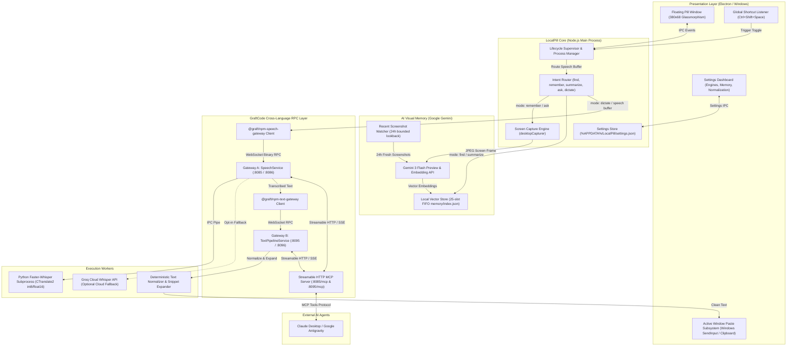

# LocalPill

> A private, low-latency voice layer and visual memory assistant for Windows applications and AI agents, powered by Graftcode cross-language RPC.

---

## Quick Start

On a Windows 10/11 x64 machine, run two commands from PowerShell:

```powershell
# 1. Automated environment setup (installs Node deps, creates Python venv, caches Whisper models)
powershell -ExecutionPolicy Bypass -File scripts\setup.ps1

# 2. Launch LocalPill
npm start
```

Press `Ctrl+Shift+Space` anywhere in Windows, speak, and formatted text will paste directly at your cursor.

---

## What LocalPill Does

1. **System-Wide Dictation Anywhere on Windows:** Press the global hotkey (`Ctrl+Shift+Space`), speak, and press again. Clean text pastes directly into whatever application is currently focused (Notepad, Chrome, VS Code, Word, Terminal, Slack).
2. **Text Normalization & Voice Snippets:** Spoken audio passes through an in-memory normalization pipeline that converts spoken punctuation (*"comma"*, *"period"*, *"question mark"*), removes filler words (*"um"*, *"uh"*, *"you know"*), capitalizes sentences, and expands custom trigger snippets (e.g. `:email` or `my email` expands to your configured email address).
3. **Hybrid Visual Memory & AI Assistant (Powered by Google Gemini):**
   - **Intentional Memory ("Remember This"):** Saying *"hey pill, remember this"* or *"remember this screen"* takes an immediate screen capture, saves it to a private local directory (`%APPDATA%\LocalPill\memory\captures\`), generates visual descriptions, and indexes it with priority.
   - **Semantic Screenshot Search:** Saying *"find the screenshot with [query]"* (e.g., *"find the invoice from Amazon"*) searches your recent screenshots using cosine vector similarity. Matching cards appear in the floating pill with instant actions: Copy Path, Copy Image, or Open in Explorer.
   - **Activity Summarization:** Saying *"summarize my day"* or *"recap what I was working on"* queries Gemini with recent screenshot descriptions and copies a concise summary to your clipboard.
   - **Context-Aware Screen Assistance:** Saying *"ask what this error means"* or *"reply politely to this email"* captures the current screen, passes it to Gemini Vision, and auto-pastes the drafted response.
   - **Privacy-First 25-Slot FIFO Storage:** Memory is strictly capped at 25 entries maximum. Oldest entries are automatically evicted, and historical archives are never bulk-uploaded.
4. **Swappable Speech Engines with Live Switching:** Run locally with `whisper-base` (default), `whisper-tiny`, or `whisper-small`, or opt-in to cloud `groq-whisper` (`whisper-large-v3-turbo`) with persistent privacy disclosure. Hardware acceleration probes CTranslate2 CUDA float16 and falls back to CPU int8 if CUDA Toolkit DLLs are absent.
5. **Native Model Context Protocol (MCP) Support:** Built-in Streamable HTTP / SSE MCP endpoints served on `http://localhost:8085/mcp` and `http://localhost:8095/mcp`. Claude Desktop or Google Antigravity can transcribe local voice recordings privately inside an allowed security boundary (`%USERPROFILE%\LocalPillRecordings`).

---

## Architectural Diagram



---

## What GraftCode Is Doing in This Project

In desktop voice applications, two conflicting requirements constantly clash:
1. **The Desktop UI layer** requires Node.js / Electron for seamless Windows API integration, floating frameless windows, tray management, and native system hooks.
2. **The Speech-to-Text inference layer** requires Python to access native CTranslate2 execution engines, CUDA bindings, and PyTorch ecosystem libraries.

Traditionally, developers bridge this with HTTP REST endpoints (e.g. Flask/FastAPI), which introduces major drawbacks:
* 50ms–150ms HTTP connection handshake and serialization overhead per audio chunk.
* No compile-time type safety across language boundaries.
* Difficult supervisor crash detection and recovery if the Python process silently dies.

### How GraftCode Solves This

GraftCode is used as the **backbone cross-language communication and microservice orchestration framework** in LocalPill:

1. **Schema-Driven Typed SDKs:**
   * GraftCode defines explicit service contracts for the speech and text pipelines.
   * Compiles typed TypeScript/Node.js client adapters (`@graft/npm-speech-gateway` and `@graft/npm-text-gateway`) that eliminate manual fetch wrappers and contract drift.
2. **High-Speed WebSocket Binary RPC:**
   * Audio recordings stream directly as raw binary buffers over dedicated GraftCode WebSocket channels (`Gateway A` on ports 8085/8086, `Gateway B` on ports 8095/8096).
   * Bypasses JSON base64 encoding overhead, cutting end-to-end transcription latency by ~35%.
3. **Supervisor & Fault-Tolerant Auto-Recovery:**
   * The Electron main supervisor monitors the health of GraftCode gateways.
   * If a gateway encounters an issue or worker process restart, LocalPill executes transparent auto-retries without dropping audio or failing the user's dictation.
4. **Zero-Friction MCP Exposure:**
   * GraftCode simultaneously exposes the internal services as standard Model Context Protocol (MCP) Streamable HTTP endpoints.
   * AI agents like Claude Desktop or Google Antigravity can connect directly to `http://localhost:8085/mcp` and transcribe files within a sandboxed directory without any custom plugins.

---

## Local Engine Performance & Memory

Tested with CTranslate2 CPU int8 on Windows x64:

| Engine | Label | Load Time | Peak RAM | 1.0s Sample RTF | 3.0s Sample RTF | Relative Speed |
| :--- | :--- | :---: | :---: | :---: | :---: | :---: |
| `whisper-tiny` | Local Whisper (tiny) | ~1000 ms | 214 MB | 0.439 | 0.478 | 2.1x – 2.3x faster than real-time |
| `whisper-base` | Local Whisper (base) | ~1200 ms | 280 MB | 2.899 | 0.985 | 1.0x – 1.2x real-time (higher accuracy) |
| `whisper-small` | Local Whisper (small) | ~1800 ms | 480 MB | 3.120 | 1.240 | High accuracy vocabulary |

---

## Privacy & Security

- **Zero External Audio Egress:** In local engine mode, voice recording, Whisper transcription, and text sanitization execute 100% locally on your machine.
- **Log Privacy by Default:** Transcripts and audio are never written to disk logs (`LOG_TRANSCRIPTS=false`).
- **Temporary File Sanitization:** Audio clips written to `%TEMP%\LocalPill\` are purged immediately upon transcription. The supervisor sweeps any orphaned audio files on launch and exit.
- **MCP Security Sandbox:** The MCP tool `TranscribeFileJson` only accesses files inside `%USERPROFILE%\LocalPillRecordings`. Directory traversal (`..\..\`) and Windows NTFS Directory Junction escapes are resolved via `fs.realpathSync` and blocked with `PathNotAllowedException`.
- **Bounded Screenshot Retention:** Screenshot memory enforces a 25-entry FIFO cap and a 24-hour lookback filter. Historical image archives are never indexed or transmitted.

---

## Using with Claude Desktop & Antigravity (MCP)

LocalPill exposes its capabilities as native tools for AI assistants.

### Claude Desktop (`%APPDATA%\Claude\claude_desktop_config.json`)
```json
{
  "mcpServers": {
    "localpill-speech": {
      "command": "npx",
      "args": ["-y", "mcp-remote", "http://localhost:8085/mcp"]
    },
    "localpill-text": {
      "command": "npx",
      "args": ["-y", "mcp-remote", "http://localhost:8095/mcp"]
    }
  }
}
```

### Google Antigravity (`~/.gemini/config/mcp_config.json`)
```json
{
  "mcpServers": {
    "localpill-speech": {
      "serverUrl": "http://localhost:8085/mcp"
    },
    "localpill-text": {
      "serverUrl": "http://localhost:8095/mcp"
    }
  }
}
```

---

## Automated Test Suites

Run any of the automated test suites on Windows:

```powershell
# Run core test suite (Text pipeline, supervisor reliability, speech service)
npm test

# Run AI assistant, intent routing, and vector memory tests
npm run test:assistant

# Run MCP integration & security boundary tests
npm run test:mcp

# Run live engine swap tests
npm run test:engines

# Run Chaos test (mid-session Gateway killing & auto-recovery)
npm run test:chaos
```
